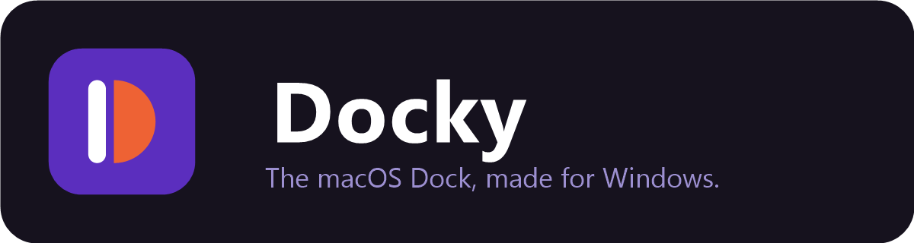

<div align="center">



**A lightweight, macOS-inspired dock for Windows 10 and 11.**

Docky replaces the Windows taskbar with a customizable dock and an optional
macOS-style menu bar.

[](https://github.com/latiefahmad/Docky/releases)
[](https://github.com/latiefahmad/Docky/blob/main/LICENSE)
[](#install)
[](#try-it-on-windows)

[⬇️ Download Docky-Setup.exe](https://github.com/latiefahmad/Docky/releases/latest/download/Docky-Setup.exe) ·
[🌐 Website](https://latief.id/docky) ·
[🗂 Releases](https://github.com/latiefahmad/Docky/releases) ·
[🐛 Report an issue](https://github.com/latiefahmad/Docky/issues)

</div>


Smooth magnification, live window previews, and an optional Genie-style
minimize effect.

| Auto-hiding Dock and Menu Bar | Genie Effect on Minimize |
| :---: | :---: |
|  |  |
| **Usage preview** | **Usage detail** |
|  |  |

## ✨ Features

- Glass-style dock with smooth, cursor-based icon magnification.
- Launch, pin, reorder, and manage apps, including recent apps and open
  windows.
- Minimized windows fold into their app's icon with the Genie effect; turn on
  Settings → Windows → *Show minimized windows* to keep them as live
  thumbnails on the right side of the dock instead.
- Click the app already in front to minimize it, as on the Windows taskbar.
- Drag and drop files onto apps, Downloads, or the Recycle Bin.
- Optional auto-hide.
- A top menu bar with the app in front, clock, network, volume and battery,
  the input language, microphone/camera in use, the hidden tray icons, plus
  the Search, Task View and Widgets buttons if you have them on the Windows
  taskbar.
- A curved island in the menu bar for usage limits from Claude Code, Codex,
  GitHub Copilot, OpenCode Go, Gemini CLI, and Antigravity. Gemini Pro and
  Flash quotas appear separately when available.
- A separate Settings app with live changes and a
  configurable Genie-style minimize animation.
- A watchdog restores the Windows taskbar if the dock exits unexpectedly.

The Genie effect is **on by default** and can be turned off in Settings →
Windows. While enabled, Docky temporarily disables Windows window transitions
for tracked windows so its minimize animation can run; those transitions are
restored when Docky exits.

## 📦 Install

**[Download Docky-Setup.exe](https://github.com/latiefahmad/Docky/releases/latest/download/Docky-Setup.exe)**
(Windows 10 version 1903 or later, or Windows 11; 64-bit) or pick a version
from [Releases](https://github.com/latiefahmad/Docky/releases).

1. Run `Docky-Setup.exe`. It installs for your user only: no administrator
   rights, no wizard, about two seconds.
2. Docky is new, so Windows SmartScreen may not recognize it yet and say it
   protected your PC. Choose **More info → Run anyway**. See the
   [code-signing policy](https://latief.id/docky/code-signing-policy).
3. Open **Docky** from the Start menu, then choose **Dock** to personalize the
   dock and top menu bar.

## 🚀 Try it on Windows

### Prerequisites

- Windows 10 (version 1903 or later) or Windows 11. On Windows 10 the dock and
  menu bar are solid instead of glass: Windows 10 has no backdrop blur for
  desktop apps.
- Rust with the MSVC toolchain and Visual Studio C++ Build Tools
- Node.js and pnpm

### Run the dock

From the repository root:

```powershell
cargo run -p docky
```

The dock hides the taskbar while it is running. Press **Ctrl+C** in the
terminal to exit; Docky should restore the taskbar automatically. If you need
to restore it manually:

```powershell
cargo run -p docky -- --restore
```

### Run Settings

Keep the dock running, open a second terminal, and run:

```powershell
cd apps\settings
pnpm install
pnpm tauri dev
```

This opens the native Settings window. Frontend changes hot-reload; after
changing the Rust backend, restart `tauri dev`. Settings changes are applied
to the running dock.

## 🧪 Build and test

From the repository root:

```powershell
cargo fmt --all -- --check
cargo test --workspace --locked
```

To build the Settings frontend:

```powershell
cd apps\settings
pnpm build
```

## 🚀 Releasing

Published versions are immutable: a fix goes into a new version, never into a
tag that is already public. Use a patch for fixes, a minor for new features
and a major for breaking changes.

1. Bump the version in `Cargo.toml` (workspace), `apps/settings/package.json`,
   `docky/package.json` and `docky/src/data/site.ts`.
2. Add a `## [x.y.z]` section to the top of `CHANGELOG.md`; the release
   workflow uses it as the release notes.
3. Commit and push, then push the matching tag:
   `git tag Docky-vx.y.z`, `git push origin Docky-vx.y.z`.
4. The Release workflow builds and signs the installer, rejects a version
   that is not newer than the latest release, and publishes it by itself.

## 🗂 Project layout

| Path | Purpose |
|---|---|
| `apps/dock` | Native Windows dock |
| `apps/settings` | Tauri desktop settings app |
| `crates/docky-core` | Platform-independent layout and animation logic |
| `crates/docky-shell` | Windows shell integration |
| `crates/docky-config` | Shared settings and persistence |
| `docky` | Astro website |

## 🔒 Privacy

Docky collects no data, has no telemetry and never sends anything to the
project. It makes two kinds of network requests, both optional:

- **Updates:** Settings asks GitHub Releases for a newer version when it
  opens, and once a day, a couple of minutes after you turn on the computer,
  Docky does the same in the background and installs what it finds (the dock
  itself never uses the network). Turn off the installing in Settings →
  System → *Install updates automatically*, or everything with *Check for
  updates automatically*.
- **AI provider usage:** while a supported client is running, Docky reads its
  existing local sign-in and asks that provider for available plan limits
  every five minutes while visible, or when you press Refresh. For Gemini CLI
  and Antigravity, Gemini Pro and Flash quotas are shown separately when
  available; Antigravity is queried through its local service. Credentials
  stay in memory and are never stored by Docky. Turn it off in Settings →
  Menu bar → *Show AI provider usage*.

Details: [latief.id/docky/privacy](https://latief.id/docky/privacy).

## 📄 License

[MIT](LICENSE). Docky continues the work of the original
[Muelle](https://github.com/crafter-station/Muelle) project by Crafter
Station — thank you for the great foundation.
